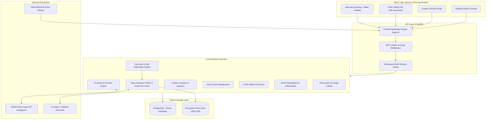
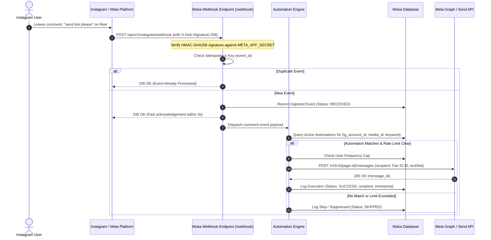

# WOKA — System Architecture

## 1. System Overview

Woka adopts a **Modular Monolith** architecture designed for velocity, operational simplicity, and cloud-native portability. It decouples the presentation layer (Next.js App Router) from the core business and domain logic (Python FastAPI), backed by an enterprise relational persistence store (SQLAlchemy 2.x with PostgreSQL / SQLite for lightweight developer execution) and an asynchronous background automation processor.



---

## 2. Layered Architecture & Directory Layout

The codebase is organized into two primary root modules (`frontend/` and `backend/`), allowing clean separation of concerns and independent dependency lifecycles:

```
woka/
├── PRD.md
├── architecture.md
├── database-schema.md
├── design-system.md
├── implementation-phases.md
├── security.md
├── testing.md
├── DECISIONS.md
├── PROGRESS.md
├── docker-compose.yml
├── backend/
│   ├── alembic/
│   │   ├── env.py
│   │   └── versions/
│   ├── alembic.ini
│   ├── requirements.txt
│   ├── app/
│   │   ├── main.py
│   │   ├── config.py
│   │   ├── database.py
│   │   ├── security.py
│   │   ├── models/            # SQLAlchemy 2.0 ORM models
│   │   │   ├── user.py
│   │   │   ├── instagram.py
│   │   │   ├── automation.py
│   │   │   ├── analytics.py
│   │   │   ├── campaign.py
│   │   │   ├── invoice.py
│   │   │   └── subscription.py
│   │   ├── schemas/           # Pydantic v2 schemas
│   │   │   ├── auth.py
│   │   │   ├── instagram.py
│   │   │   ├── automation.py
│   │   │   ├── analytics.py
│   │   │   ├── campaign.py
│   │   │   └── common.py
│   │   ├── services/          # Domain services & business logic
│   │   │   ├── auth_service.py
│   │   │   ├── instagram_service.py
│   │   │   ├── automation_engine.py
│   │   │   ├── analytics_service.py
│   │   │   ├── ai_service.py
│   │   │   └── campaign_service.py
│   │   └── routers/           # API v1 Endpoints
│   │       ├── auth.py
│   │       ├── instagram.py
│   │       ├── automations.py
│   │       ├── analytics.py
│   │       ├── ai_studio.py
│   │       ├── media_kit.py
│   │       ├── campaigns.py
│   │       ├── invoices.py
│   │       ├── subscriptions.py
│   │       └── admin.py
│   └── tests/
│       ├── conftest.py
│       ├── test_auth.py
│       ├── test_automations.py
│       ├── test_webhooks.py
│       └── test_campaigns.py
└── frontend/
    ├── package.json
    ├── tsconfig.json
    ├── tailwind.config.ts
    ├── next.config.js
    ├── src/
    │   ├── app/               # Next.js App Router pages
    │   │   ├── layout.tsx
    │   │   ├── page.tsx       # Landing page & demo preview
    │   │   ├── (auth)/
    │   │   │   ├── login/
    │   │   │   ├── register/
    │   │   │   └── onboarding/
    │   │   ├── (dashboard)/
    │   │   │   ├── layout.tsx
    │   │   │   ├── dashboard/
    │   │   │   ├── instagram/
    │   │   │   ├── automations/
    │   │   │   ├── analytics/
    │   │   │   ├── ai-studio/
    │   │   │   ├── media-kit/
    │   │   │   ├── campaigns/
    │   │   │   ├── invoices/
    │   │   │   ├── billing/
    │   │   │   └── admin/
    │   │   └── kit/[slug]/    # Public shareable media kit
    │   ├── components/
    │   │   ├── ui/            # Button, Input, Modal, Badge, etc.
    │   │   ├── layout/        # Sidebar, Topbar, Shell
    │   │   ├── automations/   # Flow builder, Rule editor, Simulator
    │   │   ├── analytics/     # Recharts metric cards, Charts
    │   │   └── shared/        # Demo badges, Stats display
    │   ├── lib/
    │   │   ├── api.ts         # Axios / Fetch HTTP client with JWT interceptor
    │   │   ├── auth.ts        # Session & token storage
    │   │   └── utils.ts       # Formatting, date helpers
    │   └── types/             # TypeScript contracts
```

---

## 3. Official Meta Instagram Integration Architecture

Woka interfaces strictly with official Meta platforms:
- **Instagram Graph API**
- **Instagram Messaging API** (part of Messenger Platform for Instagram)

### 3.1 OAuth Flow (Server-Side Authorization Code Grant)
1. Creator clicks **"Connect Instagram Account"** in Woka dashboard.
2. Woka generates a cryptographically signed OAuth URI redirecting to Facebook/Meta Login with required scopes:
   `instagram_basic`, `instagram_manage_comments`, `instagram_manage_messages`, `pages_show_list`, `pages_read_engagement`.
3. User authorizes access on Meta's consent screen.
4. Meta redirects back to `GET /api/v1/instagram/oauth/callback?code=...&state=...`.
5. Woka validates state parameter against user session (CSRF prevention).
6. Woka backend exchanges short-lived code for a user access token, queries `/me/accounts` to locate the connected Instagram Professional Account (Business or Creator account), and exchanges for a **60-day Long-Lived Page Access Token**.
7. The access token is encrypted using AES-256 before persisting into the database.

### 3.2 Real-time Webhook & Comment-to-DM Ingestion Flow



### 3.3 Sandbox / Demo Mode Architecture
Because official Meta App Review requires extensive verification (Business Verification, screencasts, App Review for `instagram_manage_messages`), Woka includes a first-class **Sandbox & Demo Simulator**:
- The UI exposes a persistent mode toggle (`Live Meta Connection` vs `Interactive Demo Sandbox`).
- In Demo Sandbox mode, users can:
  - Simulate incoming comments on sample posts.
  - Test real-time rule evaluation and preview the exact DM payload that would be dispatched.
  - Review live-rendered execution logs in the activity center.
  - Clearly see visual status tags differentiating live verified connections from mock data.

---

## 4. Multi-Tenancy & Data Isolation Model

- Every core resource (`automations`, `executions`, `campaigns`, `invoices`, `analytics_cache`) is strictly foreign-keyed to an `account_id` / `workspace_id`.
- The authentication middleware extracts `user_id` and active `workspace_id` from the verified JWT payload.
- Database queries enforce workspace boundary filtering at the ORM layer to prevent cross-tenant data leaks.
- Role-based capabilities are enforced via route dependencies:
  - `RequireRole(["CREATOR", "AGENCY", "ADMIN"])`
  - `RequireRole(["BRAND", "ADMIN"])`

---

## 5. Caching & Performance Strategy

- **API Latency:** Heavy read queries (e.g. historical analytics time series) are cached in memory or Redis with a TTL of 30 minutes.
- **Webhook Throttling:** Rapid bursts of comments (e.g. viral giveaway post with 1,000 comments/minute) are queued and processed with random 3–15 second jitter intervals to safeguard the creator's Meta API rate limits (Meta enforces 200 calls/hour per user baseline, scaling higher with active page tier).
