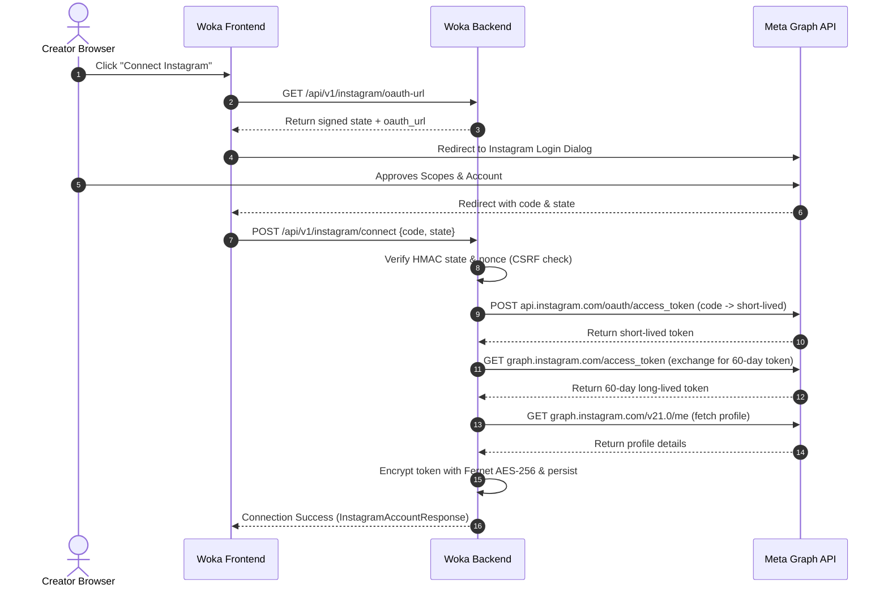

# Meta Instagram Login & Insights Integration Guide

## 1. Overview & Architecture

Woka Reel Intelligence integrates with the official **Meta Graph API (v21.0)** using **Instagram Login for Business**. This integration grants Woka access to verified professional account metrics and media insights for published Instagram Reels without credential sharing.

### Key Capabilities
- **OAuth 2.0 Authorization-Code Flow**: Secure user connection via Meta's official login dialog.
- **CSRF & Replay Mitigation**: HMAC-SHA256 signed state parameters with 15-minute expiration windows and single-use cryptographic nonces.
- **Encryption at Rest**: Access tokens are symmetrically encrypted at rest using AES-256 (Fernet) via `TOKEN_ENCRYPTION_KEY`.
- **60-Day Token Lifecycle**: Automatic exchange from short-lived tokens to 60-day long-lived tokens with refresh support before expiration.
- **Zero Fabrication Live Metrics**: When in live connected mode, real metrics (`reach`, `saved`, `shares`, `total_interactions`) are retrieved directly from `graph.instagram.com`. API errors fail gracefully with provenance tracking and never fabricate synthetic numbers.
- **Strict Tenant Isolation**: Workspace ownership is verified on all read, sync, refresh, and disconnect operations.

---

## 2. Meta Developer Portal Setup

### Step 1: Create a Meta App
1. Go to the [Meta for Developers Portal](https://developers.facebook.com/).
2. Click **Create App** and select **Business** as the app type.
3. Provide an App Name (e.g., `Woka Reel Intelligence`) and App Contact Email.

### Step 2: Add the Instagram Product
1. In the App Dashboard, navigate to **Add Products to Your App**.
2. Locate **Instagram** and click **Set Up**.
3. Under Instagram settings, configure **Instagram Login for Business**.

### Step 3: Configure Allowed Redirect URIs
1. In the Instagram Login for Business settings, find **Valid OAuth Redirect URIs**.
2. Add your application's exact redirect URIs:
   - Development: `http://localhost:3000/dashboard/instagram/callback`
   - Staging: `https://staging.woka.io/dashboard/instagram/callback`
   - Production: `https://app.woka.io/dashboard/instagram/callback`
3. Save changes.

---

## 3. Required Permissions & Scopes

Woka requests only the minimal necessary permissions:

| Scope | Purpose | App Review Required? |
| :--- | :--- | :--- |
| `instagram_business_basic` | Read basic profile info (username, user ID, profile picture, media list) | Yes (for public users) |
| `instagram_business_manage_insights` | Read organic insights for account and published Reels (`reach`, `saved`, `shares`, etc.) | Yes (for public users) |

> **Development / Testing Note**: During development, any Instagram account added to the Meta App as an **App Tester**, **Developer**, or **Admin** can authorize without App Review approval.

---

## 4. Environment Variables Configuration

Configure the following variables in your `.env` file:

```ini
# Meta App Credentials
META_APP_ID=your_meta_app_id
META_APP_SECRET=your_meta_app_secret
META_VERIFY_TOKEN=your_secure_random_webhook_verify_token
META_REDIRECT_URI=http://localhost:3000/dashboard/instagram/callback
META_API_VERSION=v21.0

# Cryptographic Token Encryption Key (Fernet AES-256 urlsafe base64)
# Generate with: python -c "from cryptography.fernet import Fernet; print(Fernet.generate_key().decode())"
TOKEN_ENCRYPTION_KEY=your_generated_fernet_key_here

# Frontend Application URL
FRONTEND_URL=http://localhost:3000
```

> [!IMPORTANT]
> Never commit `META_APP_SECRET` or `TOKEN_ENCRYPTION_KEY` to source control. Startup validation checks prevent production boots with mock or default credentials.

---

## 5. Webhook Subscriptions & Compliance Endpoints

Meta requires webhook verification and data compliance callbacks:

### 1. Webhook Challenge Verification
- **Endpoint**: `GET /api/v1/instagram/webhook`
- Handles `hub.mode=subscribe` and matches `hub.verify_token` against `META_VERIFY_TOKEN`.

### 2. Inbound Webhook Events
- **Endpoint**: `POST /api/v1/instagram/webhook`
- Validates the `X-Hub-Signature-256` header against `META_APP_SECRET`.

### 3. Deauthorization Callback
- **Endpoint**: `POST /api/v1/instagram/deauthorize`
- Validates `signed_request` from Meta and marks user account as disconnected.

### 4. User Data Deletion Callback
- **Endpoint**: `POST /api/v1/instagram/data-deletion`
- Parses `signed_request`, wipes access tokens, and returns a confirmation code and status tracking URL.

---

## 6. Token Lifecycle & Flow



### Automatic Token Refresh
Tokens expire after 60 days. The backend exposes:
- **`POST /api/v1/instagram/refresh-token`**: Calls `https://graph.instagram.com/refresh_access_token?grant_type=ig_refresh_token&access_token={token}` to obtain a new 60-day validity window.

---

## 7. App Review Preparation Checklist

When submitting for Meta App Review:
1. **Business Verification**: Verify your legal business entity in Meta Business Manager.
2. **Privacy Policy**: Provide a valid public URL describing data collection and retention.
3. **Data Deletion URL**: Supply `https://app.woka.io/api/v1/instagram/data-deletion`.
4. **Screencast Video**: Record a video demonstrating:
   - Creator logging in and clicking "Connect Instagram".
   - The permissions modal showing `instagram_business_basic` and `instagram_business_manage_insights`.
   - The Reel Intelligence dashboard displaying real engagement metrics and actionable recommendations.
5. **Testing Account**: Provide credentials for a test creator account with published Reels.
