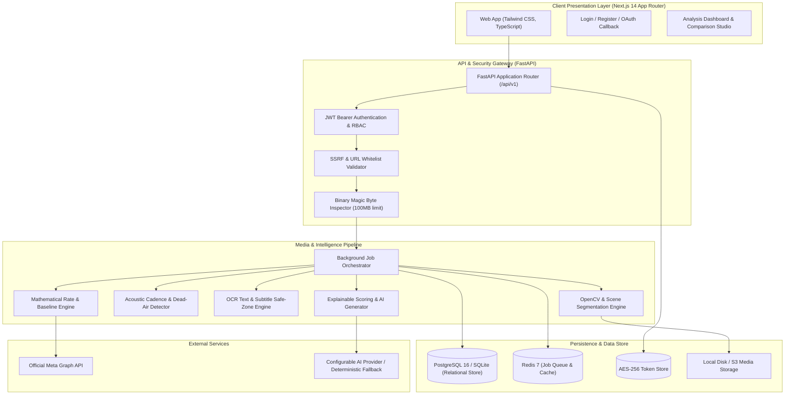
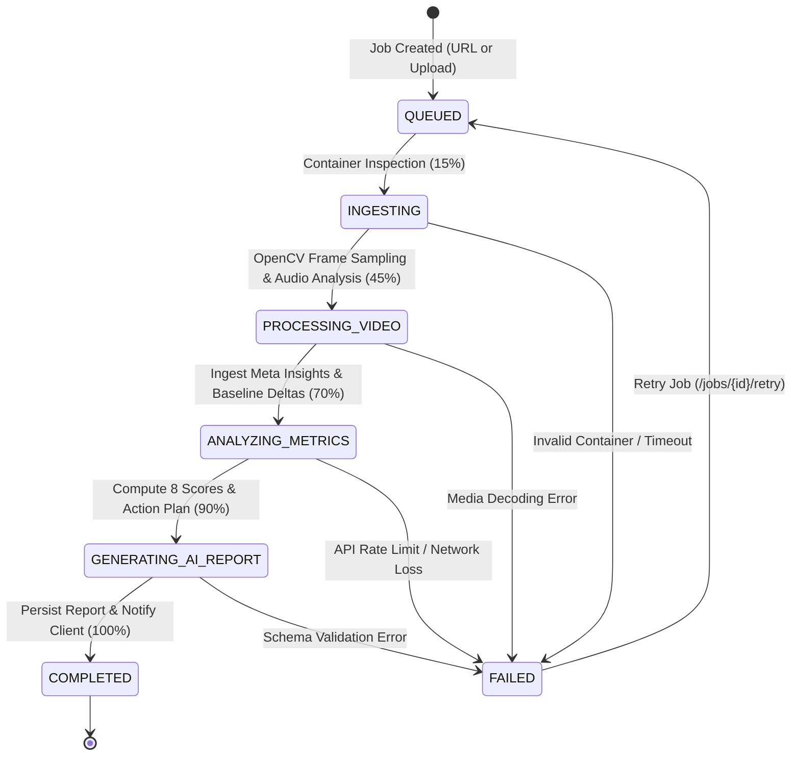

# Woka Reel Intelligence — System Architecture

## 1. High-Level Architecture Overview

Woka Reel Intelligence is built as a high-performance modular monolith with an asynchronous video and data processing pipeline.

---

## 2. Asynchronous Job State Machine

To ensure long-running media processing never blocks FastAPI HTTP request threads, jobs transition through strict states:

---

## 3. Data Flow & Security Boundary

1. **Ingestion Boundary:**
   - Public URLs are checked against SSRF IP filters before any outbound socket connection is made.
   - Uploaded files are inspected for container magic bytes (`ftyp`, `moov`, `mdat`, EBML) to prevent executable execution.
2. **Execution Boundary:**
   - Jobs are isolated to the caller's user and workspace ID.
   - Cross-tenant queries are blocked at the database layer.
3. **Storage Boundary:**
   - Sensitive Meta Page Access Tokens are encrypted with AES-256 using `TOKEN_ENCRYPTION_KEY` at rest.
