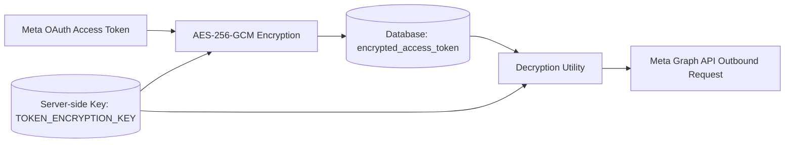

# WOKA — Security & Compliance Architecture

## 1. Compliance with Official Meta / Instagram Policies

Woka strictly adheres to the Meta Platform Terms, Developer Policies, and Instagram Platform Policy:
1. **Zero Scraping or Private APIs:** Woka **never** performs browser automation, HTML scraping, private Instagram mobile endpoint emulation, or password harvesting. All actions flow through official Meta Graph API and Instagram Messaging API endpoints.
2. **Explicit User Opt-In for Messaging:** Woka only triggers DMs in direct response to user intent (i.e. user explicitly commented on a post, requested information, or mentioned the creator).
3. **Anti-Spam & Rate Limiting Safeguards:**
   - Outbound DMs enforce per-recipient cooldown windows (minimum 60 minutes) to prevent harassment.
   - Outbound rate limit guards prevent exceeding Meta Graph API tier boundaries (typically 200 calls/hour per page baseline).
   - Execution jitter (random delays between 5 and 25 seconds) prevents burst patterns that trigger spam heuristics.

---

## 2. Authentication & Credential Security

### 2.1 Password Security
- User passwords are salted and hashed using **bcrypt** with a work factor of 12.
- Plaintext passwords are never logged, cached, or persisted.

### 2.2 JWT Tokens
- Access Tokens: Short-lived (60 minutes), signed using HMAC-SHA256 with a high-entropy secret (`JWT_SECRET_KEY`).
- Refresh Tokens: Stored securely in database with 30-day validity, rotatable upon issuance.
- Token claims include `sub` (User ID), `role`, `workspace_id`, and `exp`.

### 2.3 OAuth Token Encryption at Rest
- Instagram Long-Lived Page Access Tokens provide sensitive administrative control over creator accounts.
- All access tokens are encrypted before database insertion using **AES-256-GCM** (or Fernet with 256-bit keys).
- The encryption key (`TOKEN_ENCRYPTION_KEY`) is stored strictly in server-side environment variables and is never transmitted over HTTP or exposed to frontend clients.

---

## 3. Webhook Integrity & Signature Verification

Meta broadcasts real-time event updates via HTTP POST to `/api/v1/instagram/webhook`. To prevent spoofing and tampering:
1. **Challenge Verification (GET):** Verifies `hub.verify_token` against the server's configured `META_VERIFY_TOKEN`. Only returns `hub.challenge` if tokens match.
2. **HMAC-SHA256 Signature Verification (POST):**
   - Meta supplies header `X-Hub-Signature-256: sha256={hash}`.
   - Woka computes `HMAC_SHA256(request_body, META_APP_SECRET)`.
   - Uses constant-time comparison `hmac.compare_digest` to prevent timing attacks.
   - Any signature mismatch immediately aborts with HTTP 401 Unauthorized.
3. **Idempotency Guard:**
   - Every Meta webhook payload contains a unique `id` / `mid`.
   - The webhook processor checks the database for prior occurrence. If found, it returns `200 OK` without re-dispatching DMs.

---

## 4. Multi-Tenant Isolation & Authorization (RBAC)

1. **Workspace Scoping:** Every database query involving user content (automations, campaigns, analytics, invoices) filters on `workspace_id`.
2. **Role Boundaries:**
   - `CREATOR`: Can manage own Instagram account, automations, media kit, invoices, and view brand campaigns.
   - `BRAND`: Can create campaigns, review applications, approve creator deliverables.
   - `AGENCY`: Can manage multiple creators under a unified organization.
   - `ADMIN`: Global visibility into platform metrics, abuse moderation, and system configuration.
3. **Public vs Private Endpoints:**
   - Public: `/kit/{slug}` (Read-only creator media kit, rate card, and inquiry form submission).
   - Authenticated: All `/api/v1/` routes require valid `Authorization: Bearer <token>` unless explicitly tagged public.

---

## 5. Input Validation & Defense in Depth
- **Zero Raw SQL:** 100% of queries use SQLAlchemy 2.0 ORM with parameterized variables.
- **Pydantic v2 Schema Sanitization:** All inbound JSON payloads are strictly validated against Pydantic models. Unrecognized attributes are rejected.
- **CORS Configuration:** Explicitly restricts allowed origins to the frontend domain (`http://localhost:3000` in dev, production domain in prod).
- **HTTP Security Headers:**
  - `X-Content-Type-Options: nosniff`
  - `X-Frame-Options: DENY`
  - `Strict-Transport-Security` in production
